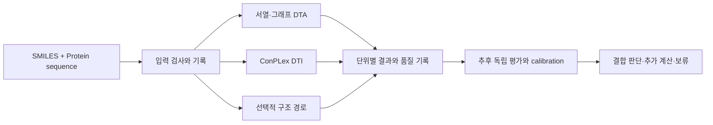

# SMILES + Protein sequence 예측 파이프라인: 첫 단계 선정

조사일: 2026-11-11. 기준 문서: [DTI.md](DTI.md).

구현 업데이트: 아래 내용은 최초 선정 시점의 조사 기록이다. 현재 CNN·MPNN·ConPLex·Boltz-2의
공식 가중치 추론·비교 실행을 구현하고 CPU/CUDA에서 확인했다. 최신 구현 범위, 입력 제한,
검증 결과는 [4모델 통합 기록](expanded-models.md)을 참조한다.

추천은 **DeepPurpose 한 체크포인트로 단일 쌍 DTA 추론 → 같은 도구의 그래프 모델 → ConPLex DTI → 언어모델 기반 DTA → 3D 경로**다. 각 단계는 앞 단계의 실제 예측이 재현된 뒤 진행한다. 첫 구현의 목표는 정확도 우승 모델을 결정하는 것이 아니라, 입력·출력·가중치·전처리를 추적할 수 있는 작은 추론 경로를 확보하는 것이다.

이번 작업은 공식 저장소·배포 페이지·소스 조사다. 가중치를 내려받아 로드하거나 예측을 실행하지 않았다. 아래에서 ‘공개 확인’은 ‘이 PC에서 실행 성공’과 다르다. 현재 작업 폴더에는 기존 방법론 문서만 있었으며, 로컬 GPU는 `NVIDIA GeForce RTX 2080 Ti / 11264 MiB`로 확인했다.

## 입력 관점에서 다시 나누기

| 경로 | 사용자가 처음 제공하는 것 | 내부에서 추가로 준비하는 것 | 첫 후보 |
| --- | --- | --- | --- |
| 서열 기반 | SMILES + 단백질 서열 | 토큰·서열 인코딩 | DeepPurpose CNN, StructureFree-DTA |
| 약물 2D 그래프 기반 | 동일 | SMILES에서 원자·결합 그래프 생성 | DeepPurpose MPNN |
| 공동 임베딩 기반 DTI | 동일 | 약물 fingerprint + 단백질 LM embedding | ConPLex |
| 단백질 구조 기반, 도킹 없음 | 동일 + 선택적 PDB/CIF | 서열에 맞는 단백질 구조 확보 및 잔기 매핑 | CASTER-DTA; InSiteDTA는 추가 검토 |
| 복합체 공동 예측 | SMILES + 단백질 서열 | MSA 준비, 복합체 구조 예측 | Boltz-2 |
| 도킹 및 구조 점수 | 동일 + 선택적 구조·포켓 | 수용체/리간드 준비, 포켓 또는 탐색 상자, 포즈 | GNINA |

**약물 2D 그래프는 별도 실험 자료가 아니다.** DeepPurpose MPNN의 전처리는 SMILES로부터 원자·결합 특징을 만든다. 반면 단백질 3D 구조는 구조 검색이나 구조 예측이라는 별도 단계가 필요하다. 따라서 사용자의 공통 입력을 두 문자열로 유지하면서 내부 경로를 확장할 수 있다. [DeepPurpose 전처리 코드](https://github.com/kexinhuang12345/DeepPurpose/blob/master/DeepPurpose/utils.py)

## 후보별 판단

| 후보 | 공개 자료에서 확인한 내용 | 출력 취급 | 제안 |
| --- | --- | --- | --- |
| DeepPurpose `CNN_CNN_BindingDB` | 사전학습 이름, 다운로드 매핑, 추론 API | 로그 affinity; 체크포인트의 endpoint 확인 후 단위 확정 | **첫 실행 후보** |
| DeepPurpose `MPNN_CNN_BindingDB` | 별도 그래프 체크포인트와 SMILES 전처리 | 위와 같은 원칙 | 두 번째, 그래프 경로 확보 |
| ConPLex `ConPLex_v1_BindingDB` | 다운로드 명령과 쌍별 추론 CLI | 현재 CLI는 cosine 기반 DTI score | 세 번째, DTI 경로 확보 |
| StructureFree-DTA | 저자 HF Space의 `Davis-Final.pth`, 추론 코드 | 우선 원시 affinity score; 라벨 변환 확인 필요 | LM 기반 DTA 실험 후보 |
| Boltz-2 | 코드·가중치 MIT, YAML 추론·affinity 지원 | binder probability와 IC50 계열 값 분리 | 첫 co-folding 후보 |
| CASTER-DTA | BindingDB 가중치 및 복원 설정 공개 | rescaling 복원·endpoint 확인 필요 | 단백질 구조 활용 경로 |
| GNINA | 내장 CNN 및 docking/scoring 사용법 | 포즈 점수·CNNaffinity·경험적 에너지 분리 | 구조 준비 이후 |
| EviDTI | Zenodo에 모델 archive 공개 | DTI 예측과 evidential uncertainty | 첫 파이프라인 이후 |

선정 순서는 구현 부담에 대한 판단이며 성능 순위가 아니다. 출처와 보류 조건은 아래에 기록했다.

### DeepPurpose: 작은 출발점

공식 저장소는 CNN·MPNN 등의 BindingDB/Davis/KIBA 사전학습 모델과 별도 BindingDB-IC50 모델을 열거한다. `model_pretrained()`와 `predict()`를 공통 wrapper에 연결하기 쉽다는 점이 선택 이유다. 이름이 `DTI`인 모듈이라도 선택한 체크포인트가 회귀 모델이면 결과는 DTA다. [공식 저장소](https://github.com/kexinhuang12345/DeepPurpose)

소스에서 확인한 구현 주의점:

- CNN 전처리에는 `MAX_SEQ_DRUG=100`, `MAX_SEQ_PROTEIN=1000` 제한과 자동 절단이 있다. 첫 wrapper는 초과 입력을 기본적으로 거절하고, 명시적으로 절단할 때만 실제 사용 범위를 기록한다.
- MPNN은 약물의 CNN 문자 길이 제한을 피하지만, 원자·결합 등 별도 제한이 있다. 단백질 CNN 제한은 유지된다.
- 일부 특징 생성 실패를 영벡터로 바꾸는 경로가 있다. wrapper가 유효하지 않은 SMILES를 먼저 거절해야 한다.
- 체크포인트 다운로드는 Harvard Dataverse를 사용한다. 코드의 링크 매핑은 확인했지만, 이번 조사에서 archive 다운로드 성공은 검증하지 못했다. [전처리·다운로드 코드](https://github.com/kexinhuang12345/DeepPurpose/blob/master/DeepPurpose/utils.py)

BindingDB loader의 기본값은 `Kd`, `convert_to_log=True`다. 다만 현재 loader의 기본값만으로 과거의 모든 체크포인트 라벨을 확정하지 않는다. 첫 구현에서 선택한 checkpoint의 학습 설명·config와 대조하고, 확인 전에는 임의로 `Kd_nM`를 반환하지 않는다. 또한 calibration 데이터를 만들 때는 loader가 `<`, `>`를 제거하는 동작을 그대로 재사용하지 말고 검출한계 표기를 보존한다. [데이터 코드](https://github.com/kexinhuang12345/DeepPurpose/blob/master/DeepPurpose/dataset.py)

### ConPLex: DTI 점수를 별도로 추가

공식 CLI는 단백질 ID, 분자 ID, 서열, SMILES로 구성된 TSV와 `ConPLex_v1_BindingDB.pt`를 받는다. 단백질 특징은 ProtBert, 약물 특징은 Morgan이다. [설치·추론 설명](https://github.com/samsledje/ConPLex)

현재 추론 코드는 `SimpleCoembeddingNoSigmoid`를 만들며 기본 cosine 출력을 사용한다. 따라서 `interaction_score`로 저장하고, 곧바로 `binding_probability`나 nM 값으로 해석하지 않는다. 확률 표시가 필요하면 별도 라벨 데이터로 확률 보정을 평가한다. ProtBert 특징 계산이 추가되므로 단백질 embedding 캐시가 유용하다. [CLI](https://github.com/samsledje/ConPLex/blob/main/conplex_dti/cli/predict.py), [모델 구현](https://github.com/samsledje/ConPLex/blob/main/conplex_dti/model/architectures.py)

### StructureFree-DTA: 가중치는 있지만 전처리 확인이 선행

GitHub와 별도로 저자의 Hugging Face Space에 67.9 MB `Davis-Final.pth`가 있다. 조사 시 배포 페이지의 SHA256은 `47990b6ad9240b578917cb44d06fab235a22280572da5e7c766c93a25184f6db`다. 이는 배포 페이지 값이며 로컬 파일 해시 검증 결과가 아니다. [현재 가중치](https://huggingface.co/spaces/amirhallaji/StructureFree-DTA/blob/main/Davis-Final.pth)

다음 항목을 해결한 뒤 adapter를 채택한다.

- HF 데모는 가중치가 없으면 무작위 가중치로 계속 진행한다. 우리 adapter에서는 반드시 실패 처리한다.
- HF 데모는 분자 128, 단백질 1024 토큰을 쓰지만 GitHub의 기본 YAML은 단백질 길이가 128이다. 배포 checkpoint의 실제 학습 전처리와 맞춰야 한다.
- 데모 출력은 단위를 밝히지 않은 affinity score다. Davis라는 이름만으로 pKd라고 단정하지 않고 라벨 출처·변환을 추적한다.
- GitHub 루트/HF 파일 목록에서 명시적 이용허가 파일을 확인하지 못했다. 배포·재사용 정책 확정 전 이용 조건을 추가 확인한다.

근거: [HF 추론 코드](https://huggingface.co/spaces/amirhallaji/StructureFree-DTA/blob/main/app.py), [GitHub 설정](https://github.com/amirhallaji/StructureFree-DTA/blob/main/cfg/config.yaml), [파일 목록](https://huggingface.co/spaces/amirhallaji/StructureFree-DTA/tree/main), [저장소](https://github.com/amirhallaji/StructureFree-DTA).

### 3D 경로: Boltz-2와 구조 기반 scoring을 구분

Boltz-2는 같은 두 입력으로 복합체 구조와 affinity 관련 출력을 얻을 수 있어 첫 co-folding 후보로 적절하다. 공식 설명상 `affinity_probability_binary`는 binder/decoy 판별, `affinity_pred_value`는 활성 분자 간 affinity 비교를 위한 `log10(IC50 / µM)`다. 두 필드를 구분해 보관한다. [공식 설명](https://github.com/jwohlwend/boltz)

MSA는 서버로 생성하거나 미리 준비한다. `msa: empty` 단일 서열 모드도 있지만 공식 문서는 정확도 저하를 명시한다. affinity는 한 ligand에 대해 요청하며, 분자 크기 제한도 있다. RTX 2080 Ti 11GB에서의 실행 가능 범위·정밀도·kernel 호환성은 짧은 표준 예제로 측정해야 하며, 임의 길이 단백질 실행을 약속할 수 없다. 첫 검증에서는 MSA 방식과 sampling 설정을 고정한다. [입력·제한·옵션](https://github.com/jwohlwend/boltz/blob/main/docs/prediction.md)

CASTER-DTA는 도킹 없이 단백질 3D와 약물 그래프를 사용한다. 공식 저장소에 BindingDB 모델 `bestvalmodel_bindingdb_val0.6889_epoch01011.pt`와 출력 rescaling을 위한 설정이 안내되어 있다. 서열에 맞는 PDB/예측 구조, chain·잔기 대응을 준비해야 한다. 저장소는 비상업·학술 이용과 상업 이용을 구분하는 별도 라이선스를 명시하므로, 일반적인 무제한 오픈소스 후보와 구별한다. [CASTER-DTA](https://github.com/rachitk/caster-dta)

GNINA는 단백질 구조와 리간드 구조, 도킹 탐색 영역을 준비한 뒤 추가한다. `CNNscore`는 포즈 품질, `CNNaffinity`는 pK 계열 affinity 예측이고 경험적 docking energy와도 다르다. `--score_only`로 점수화하려면 리간드 포즈가 수용체와 같은 좌표계에 있어야 한다. [공식 저장소](https://github.com/gnina/gnina), [개발팀 실습 자료](https://bits.csb.pitt.edu/rsc_workshop2021/docking_with_gnina.slides.html)

EviDTI의 Zenodo record에는 `runs.zip` 약 835 MB가 실제로 등재되어 있다. 따라서 가중치 부재로 제외할 모델은 아니다. 다만 새 입력의 단백질 서열 특징과 약물 2D·3D 특징 생성 경로를 연결해야 한다. evidential uncertainty는 나중에 비교할 가치가 있지만 conformal prediction과 동일한 보장은 아니다. [저장소](https://github.com/zhaoyanpeng208/EviDTI), [모델·특징 배포](https://zenodo.org/records/14056305)

### 추가 발견·업데이트 후보

- **InSiteDTA**: 공식 README에 PDB + SMILES 단일 추론 명령, checkpoint 경로, pK 출력이 있다. 명시적 포켓 입력 없이 동작하는 구조 기반 후보다. 이번에는 checkpoint 실물·실행·논문 검증까지 확인하지 않았으므로 CASTER-DTA의 추가 비교 후보로 둔다. [저장소](https://github.com/KU-MedAI/InSiteDTA)
- **dtSFM**: 현재 저장소는 HF `SFM-BIIE-ETHZ/dtSFM-v3`를 안내한다. affinity head는 preliminary로 설명하고 Research Preview 조건을 명시한다. 검색·특이성 점수 연구 후보로 두되 검증된 범용 절대 affinity 예측기로 취급하지 않는다. [공식 저장소](https://github.com/Reddy-BIIE-ETHZ/dtSFM)
- **AffinityNet/AffinityLM**: 최근 논문의 연결 저장소를 확인했으나 조사 시 README가 제목 수준이었다. 첫 실행 후보로 판단할 만큼의 배포·추론 근거를 확보하지 못했다. [저장소](https://github.com/AI4Med-Lab/affinitynet-benchmark)

기존 DTI.md의 모든 모델을 이번에 재검증한 것은 아니다. 특히 GraphDTA·DrugBAN의 ‘재학습 필요’ 같은 표기는 영구적 사실로 두지 말고, 채택 시점에 공식 checkpoint 공개 여부를 다시 확인한다.

## 작은 구현 단위와 완료 조건

| 단계 | 구현할 것 | 완료 조건 |
| --- | --- | --- |
| M1 | DeepPurpose CNN 한 모델, 한 입력 쌍 → JSON | 실제 checkpoint 로드, 유한한 원시 값, endpoint/scale 근거, 재실행 확인 |
| M2 | DeepPurpose MPNN 추가 | 같은 입력에 두 결과, 실패를 모델별로 기록, 자동 평균 없음 |
| M3 | ConPLex 추가 | DTA 값과 DTI score를 구분한 결과 생성 |
| M4 | StructureFree-DTA adapter | 가중치·전처리·라벨 의미·이용 조건 확인, LM 경로 재현 |
| M5 | Boltz-2 단일 소형 예제 | 구조 파일, affinity JSON, 구조 confidence, 시간·최대 VRAM 기록 |
| M6 | CASTER-DTA 또는 GNINA 중 하나 | 서열→구조 매핑 및 구조 준비 기록, 구조 기반 출력 생성 |
| M7 | 평가·calibration | 학습 중복 조사, 독립 calibration/test, 단위별 평가 |
| M8 | 결합 판단·agent routing | 검증된 출력만 사용해 추가 계산·보류·설명을 결정 |

평가·calibration은 M1 이후 독립 라벨 데이터가 준비되는 대로 시작할 수 있다. 모든 모델이나 3D 경로의 완성을 기다릴 필요는 없다. 모델을 추가하거나 최종 predictor를 변경하면 해당 버전에 맞춰 다시 calibration한다.

**바로 다음 구현 범위는 M1 하나**다. 입력은 `smiles`, `protein_sequence`, 선택적 ID로 제한한다. 출력에는 숫자뿐 아니라 해석 가능한 단위와 실행 근거가 있어야 한다. 첫 검증용 분자는 checkpoint의 입력 범위에 맞는 공개 예제를 고르고, 이 예제의 정상 출력은 과학적 일반화 성능 검증과 구별한다.

M1의 첫 검증은 정상 쌍 추론, 같은 입력 재실행, 잘못된 SMILES, 길이 초과 서열, 누락된 가중치 처리다. 공개 예제의 기대값이 확보되면 허용 오차 내 비교를 추가한다. 소수 예제의 순위가 그럴듯하다는 이유만으로 정확도 또는 uncertainty 성능을 주장하지 않는다.

설치는 모델 계열별 가상환경으로 분리한다. 공통 runner는 처음에는 Python 함수 또는 subprocess 호출이면 충분하다. Windows에서 시작하되 구조 모델의 Linux 의존성이 확인되는 경우 해당 adapter만 WSL/Linux로 분리한다. 환경·cache는 프로젝트 내부에 두고, GPU 모델은 한 번에 하나씩 로드한다. 구체적인 Python/PyTorch 버전은 첫 실제 설치에서 확인하고 고정한다.

## 공통 결과 계약

처음부터 필요한 필드는 아래 정도다. 향후 모델을 추가해도 이전 결과의 의미가 바뀌지 않아야 한다.

| 필드 | 내용 |
| --- | --- |
| `input` | 원본 SMILES·서열, 사용한 표현, normalization 정책, 입력 hash |
| `model` | 이름, code revision, checkpoint URL/revision/SHA256, 학습 데이터·endpoint 근거 |
| `prediction` | 원시 값, endpoint, scale, 증가/감소 방향, 의미 확인 상태 |
| `derived` | 의미가 확인된 경우에만 단위 변환값 |
| `quality` | 입력 제한, 절단·서열 치환, 구조 출처·mapping, OOD 평가 여부 |
| `uncertainty` | 종류, calibration 상태, 구간/집합; 미실시라면 명시적 null |
| `execution` | 성공/실패/미지원, 오류, seed, device, 실행시간, 실제 환경 |

SMILES canonicalization, salt 처리, tautomer/protonation 변경은 별개 작업이다. 원본을 보존하고 모델 학습 전처리와 일치하는 정책만 적용한다. 서열도 원본과 실제 사용한 길이·domain 범위를 기록하며, 긴 단백질을 조용히 자르지 않는다. ‘임의 입력’은 API로 접수할 수 있다는 의미이지 모든 화학종·단백질·복합체에 대해 유효한 affinity를 보장한다는 의미는 아니다.

### 숫자를 합치기 전에 지킬 규칙

| 출력 | 해석 / 허용 변환 | 취급 |
| --- | --- | --- |
| 확인된 pKd | `Kd_nM = 10^(9 - pKd)` | Kd 계열 안에서 비교 |
| 확인된 pIC50 | `IC50_nM = 10^(9 - pIC50)` | IC50 계열 안에서 비교 |
| Boltz 원시 값 `a` | 공식 scale에 따라 `pIC50_like = 6 - a`, `IC50_like_nM = 10^(a + 3)` | 원시 값 보존; Kd와 동일시하지 않음 |
| KIBA score | 데이터셋 고유 통합 점수 | 일반적인 nM 변환을 적용하지 않음 |
| ConPLex score | 공동 임베딩 상호작용 점수 | 별도 DTI 근거 |
| pLDDT/ipTM/CNNscore | 구조·포즈 관련 confidence | 결합 확률·affinity 구간으로 사용하지 않음 |

Boltz scale 근거는 [공식 affinity 설명](https://github.com/jwohlwend/boltz#binding-affinity-prediction), KIBA의 통합 점수 성격은 [StructureFree-DTA의 데이터 설명](https://github.com/amirhallaji/StructureFree-DTA)에 기록되어 있다. 변환은 단위를 맞추는 수학적 연산이며 assay나 학습 분포 차이를 없애지 않는다. 같은 pKd 출력도 서로 다른 데이터·표적 범위에서 학습했으면 오차와 편향을 평가한 뒤 결합한다.

## Conformal prediction과 agent는 어떻게 붙일까

Conformal prediction은 모델 여러 개의 표준편차에 붙이는 이름이 아니다. 학습·모델 선택과 분리된 정답 calibration 데이터가 필요하다. 첫 방식은 endpoint별 split conformal regression으로 충분하다. 고정 predictor의 calibration residual `s_i = |y_i - f(x_i)|`에서 `k = ceil((n+1)(1-alpha))`번째 순서통계량 `q`를 구하고 `[f(x)-q, f(x)+q]`를 반환한다. `k > n`이면 유한 구간을 얻을 표본이 부족한 경우로 처리한다. [Conformal prediction 입문](https://arxiv.org/abs/2107.07511)

DTI 분류에는 `{binder}`, `{non-binder}`, `{binder, non-binder}` 같은 예측 집합을 만들 수 있고, 방법에 따라 빈 집합도 가능하다. 확률 보정과 conformal coverage는 별도 평가 대상이다. 표준 conformal 보장은 calibration/test의 교환가능성 등에 의존하는 주변적 coverage이며 개별 쌍의 정확도를 보장하지 않는다. [회귀·분류·분포 이동 설명](https://arxiv.org/html/2107.07511v6)

이 프로젝트에 적용할 평가 설계 제안:

- calibration에는 실험 endpoint와 단위가 명확한 자료를 쓰고, 동일 쌍 중복·assay 차이·검출한계·측정 조건을 기록한다.
- 공개 pretrained checkpoint의 학습 목록을 알 수 없으면 ‘학습과 독립인 calibration’ 검증 상태를 미확인으로 둔다. 임의로 다시 random split했다고 누수가 해결되지는 않는다.
- random pair, cold drug/scaffold, cold target/sequence cluster, 둘 다 새로운 경우를 나누어 성능과 경험적 coverage를 확인한다. cold split 자체가 교환가능성을 보장하지는 않는다.
- 앙상블 가중치나 모델 선택은 별도 validation에서 정하고, 고정된 최종 predictor를 calibration한다. 개별 conformal 구간을 임의로 교집합해 같은 보장을 주장하지 않는다.
- 첫 구현은 모델별 값·불일치만 보여준다. ensemble variance와 evidential uncertainty는 비교 신호로 보존하며, calibration 전에는 검증된 예측 구간으로 표시하지 않는다.
- 모델 실행 여부를 점수에 따라 바꾸는 routing까지 최종 시스템의 일부다. routing 규칙을 고정한 뒤 해당 정책의 평가·calibration을 수행한다.

Agent의 첫 역할은 입력 검사, adapter 실행, 실패·자원 상태 처리, 출력 근거 정리다. 이후 입력 범위·구조 유무·모델 불일치·보정 상태에 따라 추가 계산을 선택하게 한다. LLM이 서로 다른 점수를 읽고 임의의 affinity 숫자나 확신도를 만들어내는 동작은 피한다.

첫 결과물은 **두 문자열을 입력해, 검증된 사전학습 가중치로 계산한 단일 예측값과 그 의미를 JSON으로 남기는 실행기**다. 이후 같은 계약에 모델 하나씩 연결하면 장기 목표인 다중 모델 판단과 conformal prediction으로 확장할 수 있다.
